

  
  
  
  
  
  
  
  

  <a href="README.md">📖简体中文</a> | 📖English

## Platform Overview

**Make existing algorithms manageable, accessible, and reusable.**

**qModel is an open-source algorithm and model management and serving platform.** It supports three model integration methods: **API Integration, Local Python Integration, and Remote SSH Integration**. The platform provides capabilities such as model version management, input and output definitions, online debugging, computation tasks, result visualization, and invocation tracing, helping developers integrate existing algorithms into business systems and continuously reuse them across teams.

From individual algorithm validation and research deliverables to business system integration and team-wide model sharing, qModel brings distributed programs, interfaces, and usage documentation together. It helps algorithm developers deliver their work more clearly, business developers integrate algorithms more efficiently, and teams continuously benefit from their accumulated model assets.

✨✨✨**Online Documentation**✨✨✨ <a href="https://community.qmodel.tech" target="_blank">https://community.qmodel.tech</a>

✨✨✨**Open Source Edition Demo**✨✨✨ <a href="https://demo.qmodel.tech" target="_blank">https://demo.qmodel.tech</a> (Username: `qModel`, Password: `qModel123`)

✨✨✨**Professional Edition Demo**✨✨✨ <a href="https://pro-demo.qmodel.tech" target="_blank">https://pro-demo.qmodel.tech</a> To obtain a demo account, please [contact our customer service team](https://community.qmodel.tech/business/policy.html).

License: **Apache License 2.0 with additional qModel project terms**. For details, see [LICENSE](LICENSE) and [Licensing and Commercial Services](#license-and-services).

## Key Features

### Multi-Language and Multi-Format Integration: Bring Existing Algorithms Under Unified Management

qModel supports **API Integration, Local Python Integration, and Remote SSH Integration**, associating algorithms from different sources with model descriptions, parameter definitions, classification tags, and version information.

Existing model services can be integrated through interface adaptation, with centralized management of request addresses, data formats, and authentication configurations, reducing repetitive integration efforts across teams.

### Algorithm Serving: Bring Algorithm Capabilities into Business Systems

Through **input and output definitions, interface adaptation, API invocation documentation, and access credential management**, qModel establishes clear usage conventions between algorithm developers and business developers.

Consumers can understand the purpose of a model, prepare input parameters, and retrieve computation results. Online debugging and invocation records help identify and troubleshoot issues, enabling algorithms to evolve from standalone deliverables into continuously utilized capabilities.

### Model Asset Management: Keep Models, Versions, and Usage Records Traceable

Centrally manage model identifiers, classification tags, versions, and statuses. Through **version comparison, computation history, and invocation tracing**, users can understand how models have evolved, who has used them, and what results they have produced.

Combined with model discovery, usage documentation, and evaluations in the Model Marketplace, teams can more easily discover existing capabilities and reuse them across different projects.

### Lightweight and Easy to Use: Get Started Smoothly from Deployment to Model Execution

qModel provides online demos, Docker Compose deployment, and manual deployment options, allowing users to choose the most suitable approach for their needs.

Through a visual interface, users can complete **parameter configuration, model debugging, computation tasks, and result inspection**. Structured results, field descriptions, charts, and export capabilities help developers and business users better understand computation outcomes.

### Open Source and Extensible: Integrate and Customize According to Project Requirements

Built with **Java, Spring Boot, and Vue 3**, qModel organizes its codebase into modules such as model management, the core framework, and system management.

Developers can explore the implementation, integrate business systems, and extend capabilities related to model integration, computation logic, interface adaptation, and result visualization. They can also contribute to the project through code, documentation, and model examples.

## Quick Start

### Online Demo

Visit the [qModel Open Source Edition Demo](https://demo.qmodel.tech) to explore the platform without installation.

**Username: `qModel` | Password: `qModel123`**

We recommend exploring the platform in the following order:

1. **Explore Models**: Select an available model in the Model Center and review its purpose, version, input parameters, and output descriptions.
2. **Execute Computations**: Navigate to Model Computation, select a model and version, configure input parameters or files, and execute the task.
3. **Review Results**: Check execution status, inputs, outputs, and runtime logs, and locate the corresponding record in the computation history.
4. **Explore Business Integration**: Review the model's API invocation documentation and credential requirements to understand how business systems can access its capabilities.

Available operations in the demo environment depend on account permissions. To integrate your own models, deploy an independent environment and follow the same process to complete model validation.

### Choose a Deployment Method

- **[Docker Compose Deployment](https://community.qmodel.tech/docs/deploy/docker-compose-deployment.html)**: Configure and launch a local environment by following the documentation. Suitable for quick evaluation and deployment.
- **[Manual Deployment](https://community.qmodel.tech/docs/deploy/manual-deployment/)**: Install and manage services independently. Suitable for existing infrastructure and customized deployment requirements.

> For first-time users, Docker Compose is recommended to quickly set up the environment and validate platform capabilities.

## Product Architecture

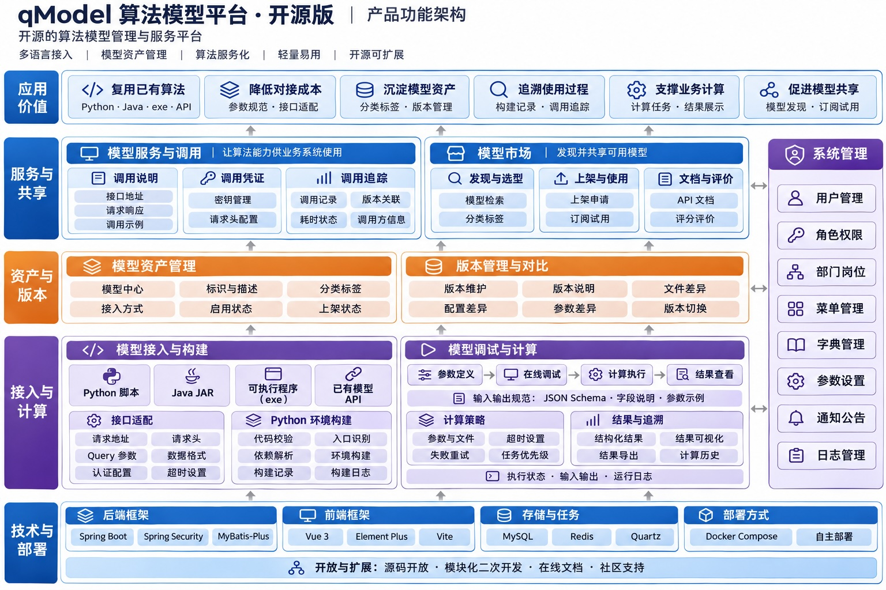

## System Screenshots

<table>
    <tr>
        <td>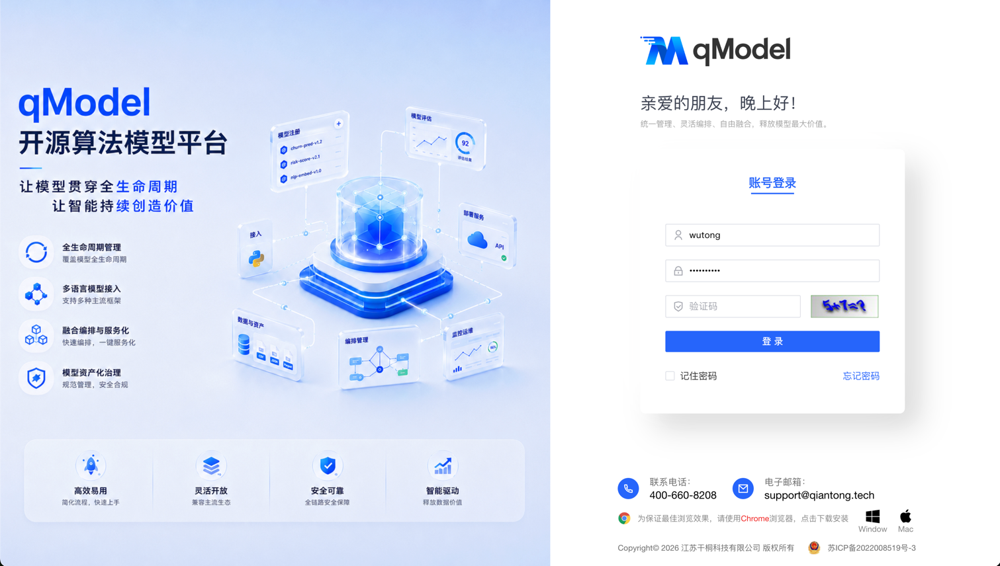</td>
        <td>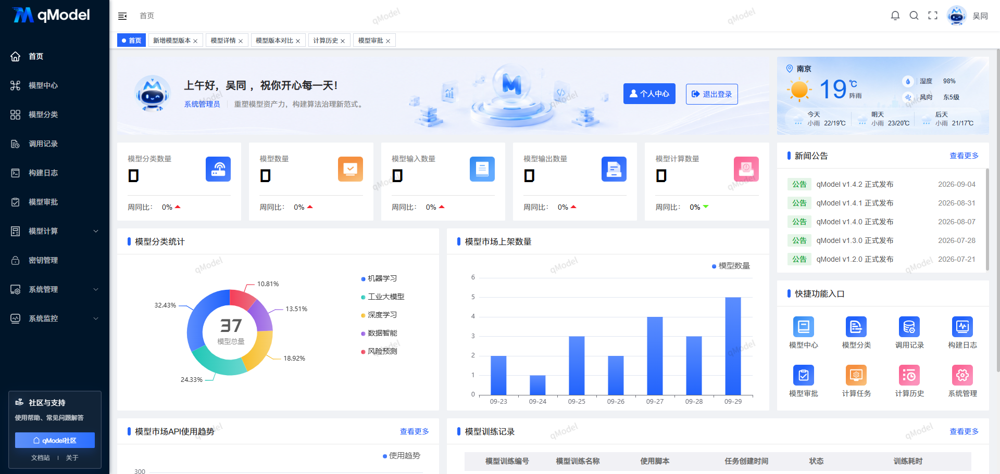</td>
    </tr>
    <tr>
        <td>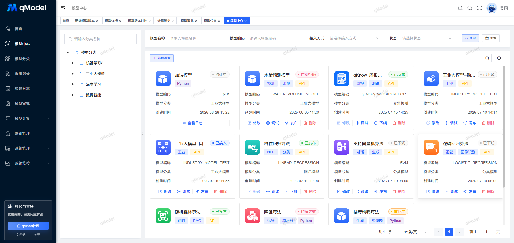</td>
        <td>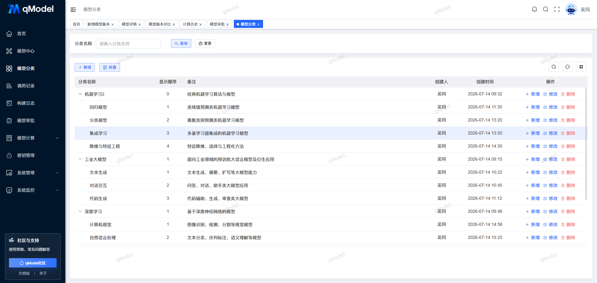</td>
    </tr>
    <tr>
        <td>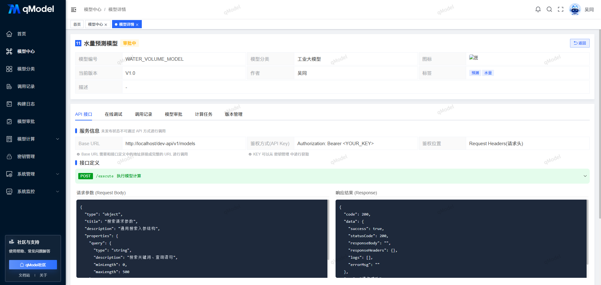</td>
        <td>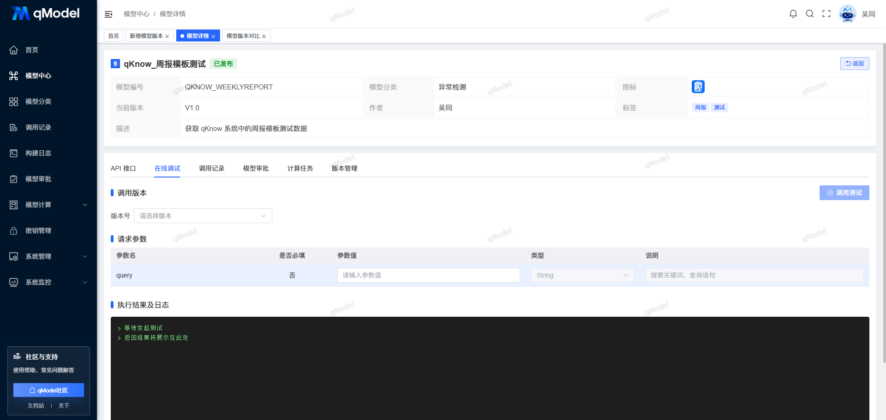</td>
    </tr>
    <tr>
        <td>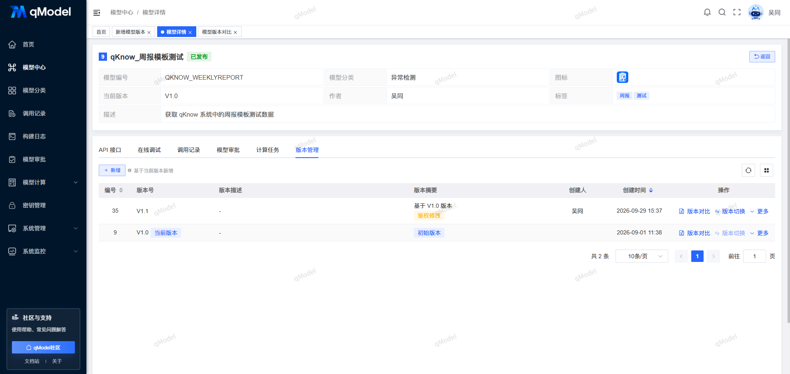</td>
        <td>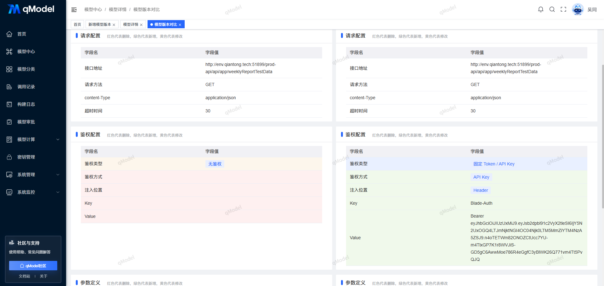</td>
    </tr>
    <tr>
        <td>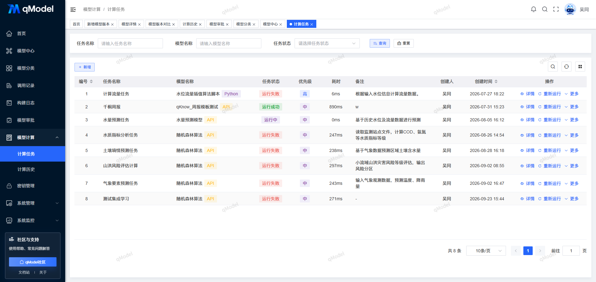</td>
        <td>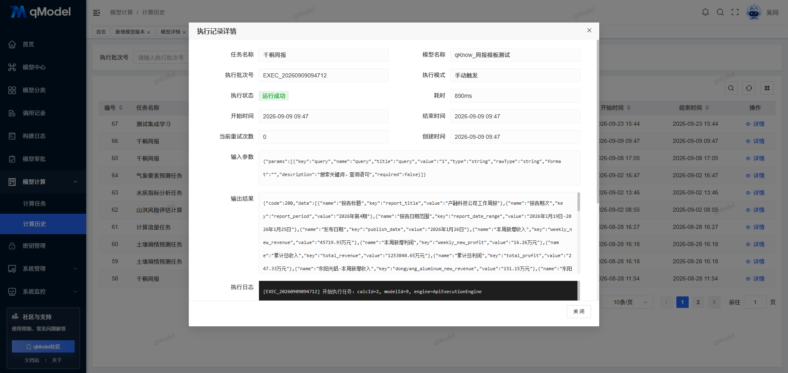</td>
    </tr>
    <tr>
        <td>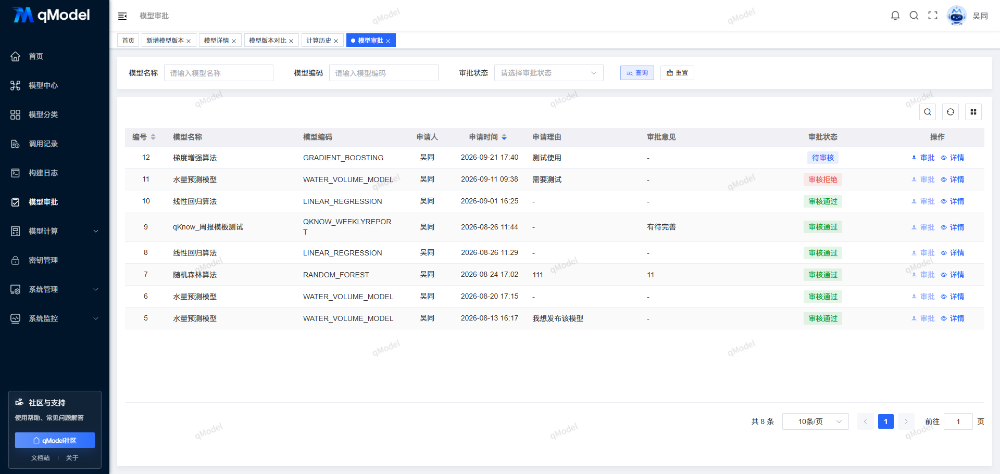</td>
        <td>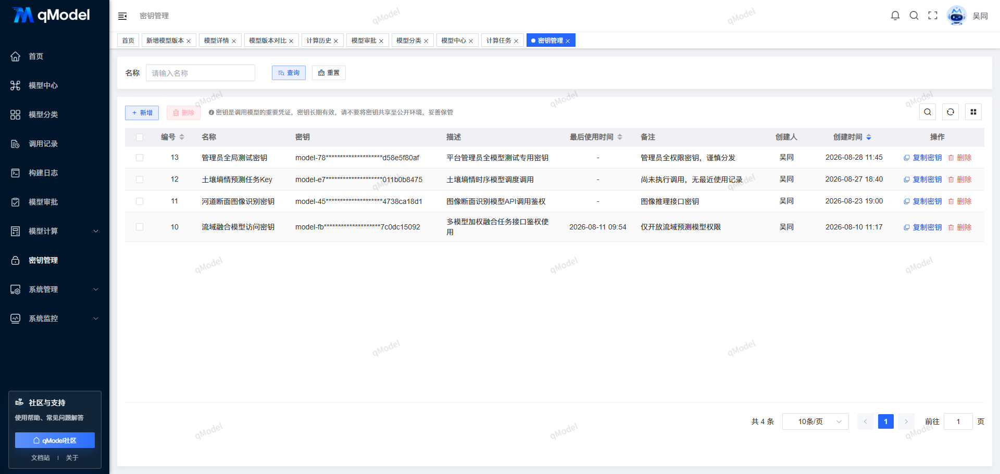</td>
    </tr>
</table>

## Capabilities Overview

| Capability | What You Can Do |
| --- | --- |
| **Model Integration and Interface Adaptation** | Integrate algorithm programs and existing model services. Configure API addresses, request headers, query parameters, data formats, and timeouts, and adapt to external service authentication requirements, including static and dynamic tokens. |
| **Model Asset Management and Classification** | Maintain model identifiers, purposes, classification tags, integration methods, enabled statuses, and listing statuses. Discover and reuse models by category and business purpose. |
| **Python Runtime Environment and Build Management** | Validate code files, identify execution entry points, resolve dependencies, and configure runtime environments. Review build status, build time, and build details to verify the build process and its results. |
| **Input/Output Specifications and Debugging** | Define input parameters using JSON Schema, and establish invocation conventions through output field descriptions and examples. Inspect responses, logs, and output structures for specific model versions. |
| **Version Management and Comparison** | Maintain version descriptions, compare changes in model files, configurations, and parameter definitions, switch between versions, and trace historical changes. |
| **Computation Tasks and Execution Strategies** | Select models and versions, configure input parameters, files, timeouts, retry counts, and priorities, and organize manageable business computation tasks. |
| **Computation Results and Visualization** | View structured results, field descriptions, and applicable charts. Export computation results and review inputs, outputs, and execution processes through execution records. |
| **Model Invocation and Tracing** | Manage model access credentials and inspect callers, client IP addresses, model versions, invocation types, latency, timestamps, and statuses to support integration testing and troubleshooting. |
| **Model Marketplace and Sharing** | Discover models through categories, tags, and evaluations. View API service documentation, submit model listing requests, subscribe to and try models, and collect usage feedback. |
| **User and Permission Management** | Manage users, roles, departments, positions, menus, dictionaries, parameters, notifications, and logs, providing foundational management capabilities for model usage and team collaboration. |

The capabilities listed above focus on the Open Source Edition. For detailed instructions, please refer to the [User Documentation](https://community.qmodel.tech). For information about Professional Edition extensions, see [Licensing and Commercial Services](#license-and-services).

## Model Integration and Execution

qModel provides unified integration, management, and invocation capabilities for algorithm models deployed in different environments. It supports three integration methods: API Integration, Local Python Integration, and Remote SSH Integration.

Users can select the appropriate integration method based on the delivery format, deployment location, and runtime requirements of their existing algorithm models, without requiring extensive modifications to the original algorithms.

| Integration Method | Description | Prerequisites |
| --- | --- | --- |
| **API Integration** | Integrate algorithm models deployed on external servers through API interfaces. qModel centrally initiates requests and retrieves computation results without requiring migration of the models or their runtime environments. | Prepare the API service address, request method, input and output parameters, and authentication information. Verify service availability and network connectivity. |
| **Local Python Integration** | Upload a Python model directory that complies with platform specifications. qModel installs dependencies and builds the runtime environment on its host server, supporting both local execution and Docker-based containerized execution. | Prepare the model code, dependency file (`requirements.txt`), standardized execution entry point (`predict.py`), and related model resource files. Specify the Python version, input and output parameters, and runtime environment requirements. |
| **Remote SSH Integration** | Connect to an external server through SSH, remotely execute existing algorithm model scripts, and retrieve computation results. Models do not need to be migrated or exposed as API services in advance. | Prepare remote server connection information, SSH authentication credentials, algorithm execution scripts, execution commands, and input and output parameters. Ensure that the remote server has a complete model runtime environment. |

After a model is integrated, the platform centrally manages its basic information, version information, input and output definitions, and runtime configurations.

Users can validate model execution and computation results through online debugging or computation tasks. Once validated, models can be accessed by business systems and reused across teams, enabling a transition from distributed deployment and independent execution to unified management and invocation.

## Development and Extension

qModel adopts a decoupled frontend and backend architecture with a modular design, making it easier for developers to understand model management workflows, integrate business systems, and extend platform capabilities.

| Layer | Main Technologies |
| --- | --- |
| Backend | Java, Spring Boot, Spring Security, MyBatis-Plus |
| Frontend | Vue 3, Element Plus, Vite, Pinia, ECharts |
| Task Scheduling and Data Storage | Quartz, MySQL, Redis, Local File Storage |
| Deployment | Docker Compose or manual deployment, with runtime environments configured according to model types |

For development environment requirements, initialization configurations, and startup instructions, please refer to the [Source Code Startup Guide](https://community.qmodel.tech/docs/deploy/manual-deployment/).

Dependency versions are subject to the build and configuration files of the release being used.

## QQ Community

Welcome to the official qModel QQ community, where you can receive the latest updates, obtain technical support, and exchange ideas with other users.

👉 <a href="https://community.qmodel.tech/discuss.html">Click to Join the QQ Community</a>

## Licensing and Commercial Services

qModel is distributed under the **Apache License 2.0 with additional project terms** and supports commercial use.

Users must comply with the [LICENSE](LICENSE) requirements and retain the required logos, copyright notices, licensing information, and attribution information.

If you need to remove or modify relevant branding, white-label the platform, use it for OEM purposes, or repackage it as another product, please obtain the appropriate commercial authorization.

For brand customization authorization, Professional Edition inquiries, and technical services, please refer to our [Commercial Cooperation Policy](https://community.qmodel.tech/business/policy.html).

## Our Mission and Vision

**Enable every developer and every enterprise to manage, use, and reuse algorithm capabilities more easily.**

We believe that algorithm development outcomes should be clearly delivered, continuously maintained, and genuinely utilized in business scenarios.

Through open source, qModel connects algorithm developers, business developers, and user teams, providing clear version information, parameter definitions, and invocation methods for models developed in different languages and from different sources, allowing the results of a single algorithm development effort to serve more projects.

We look forward to working with the community to build an easy-to-use, open, and sustainably extensible algorithm and model platform, transforming individual algorithm expertise into reusable capabilities and enabling the models accumulated by teams to continuously create value.
