

 
 
 
 
 
 
 

  📖简体中文 | <a href="README.md">📖English</a>

## 平台简介

**让已有算法可管理、可调用、可复用。**

**qModel 算法模型平台是一款开源的算法模型管理与服务平台。** 支持 **Python、Java JAR、可执行程序及已有模型 API** 等多语言、多形态的算法模型，通过 **API 接入、Python 本地接入、SSH 远程接入** 实现统一管理与调用，提供模型版本、输入输出定义、在线调试、计算任务、结果展示与调用追踪等能力，帮助开发者将已有算法融入业务系统，实现算法资产的持续复用。

从个人算法验证、科研成果交付，到业务系统集成和团队模型共享，qModel 将分散的程序、接口与使用说明组织起来，让算法作者交付得更清楚，让业务开发者接入得更顺畅，让团队积累的模型持续发挥作用。

✨✨✨**在线文档**✨✨✨ <a href="https://community.qmodel.tech" target="_blank">https://community.qmodel.tech</a>

✨✨✨**开源版演示地址**✨✨✨ <a href="https://demo.qmodel.tech" target="_blank">https://demo.qmodel.tech</a> （账号：`qModel`，密码：`qModel123`）

✨✨✨**专业版演示地址**✨✨✨ <a href="https://pro-demo.qmodel.tech" target="_blank">https://pro-demo.qmodel.tech</a> 演示账号请[联系客服获取](https://community.qmodel.tech/business/policy.html)

许可：**Apache License 2.0 及 qModel 项目附加条件**，详见 [LICENSE](LICENSE) 与[许可与商业服务](#license-and-services)。

## 核心特点

### 多语言、多形态接入：让已有算法进入统一管理

支持 **Python、Java JAR、可执行程序及已有模型 API** 等多语言、多形态的算法模型，通过 **API 接入、Python 本地接入、SSH 远程接入** 实现统一管理，关联模型描述、参数定义、分类标签及版本信息，统一维护接口配置、运行环境与调用方式，降低算法接入成本，减少跨团队集成时的重复对接。

### 算法服务化：让算法能力进入业务系统

通过 **输入输出定义、接口适配、API 调用说明与调用凭证管理**，为算法作者和业务开发者建立清楚的使用约定。调用方可以了解模型用途、准备参数并获取结果，结合在线调试和调用记录定位问题，推动算法从交付文件走向持续使用。

### 模型资产管理：让模型、版本与使用记录清楚可查

集中维护模型标识、分类标签、版本与状态，通过 **版本差异对比、计算历史和调用追踪**了解模型怎样变化、被谁使用、产生什么结果。结合模型市场中的发现、使用说明与评价，让团队更容易找到已有能力并在不同项目中复用。

### 轻量易用：从平台部署到模型计算顺畅开始

提供在线体验、Docker Compose 与自主部署入口，按使用场景选择开始方式。通过可视化界面完成 **参数配置、模型调试、计算任务和结果查看**，以结构化结果、字段说明、图表与导出能力帮助开发者和业务人员理解计算结论。

### 开源可扩展：按项目需要集成与二次开发

采用 **Java、Spring Boot 与 Vue 3** 技术栈，按模型管理、基础框架和系统管理等模块组织代码。开发者可以阅读实现、对接业务系统，围绕模型接入、计算逻辑、接口适配和结果展示进行二次开发，并通过代码、文档与模型示例参与共建。

## 快速开始

### 在线体验

访问 [qModel 开源版演示环境](https://demo.qmodel.tech)，无需安装即可了解产品。

**账号：`qModel`　密码：`qModel123`**

建议按以下顺序体验：

1. **了解模型**：在模型中心选择可用模型，查看用途、版本、输入参数与输出说明。
2. **执行计算**：进入模型计算，选择模型及版本，配置输入参数或文件并执行任务。
3. **核对结果**：查看执行状态、输入输出和运行日志，在计算历史中找到对应记录。
4. **了解业务调用**：查看模型的 API 调用说明与凭证要求，了解业务系统如何使用这项能力。

演示环境的可操作范围以账号权限为准；需要接入自己的模型时，可部署独立环境后按相同过程完成验证。

### 选择部署方式

- **[Docker Compose 部署](https://community.qmodel.tech/docs/deploy/docker-compose-deployment.html)**：按文档配置并启动本地环境，适合快速体验与部署。
- **[自主部署](https://community.qmodel.tech/docs/deploy/manual-deployment/)**：自行安装与管理服务，适合已有基础设施及个性化部署需求。

> 首次体验推荐使用 Docker Compose 部署方式，可以更快完成环境启动和功能验证。

## 产品功能架构

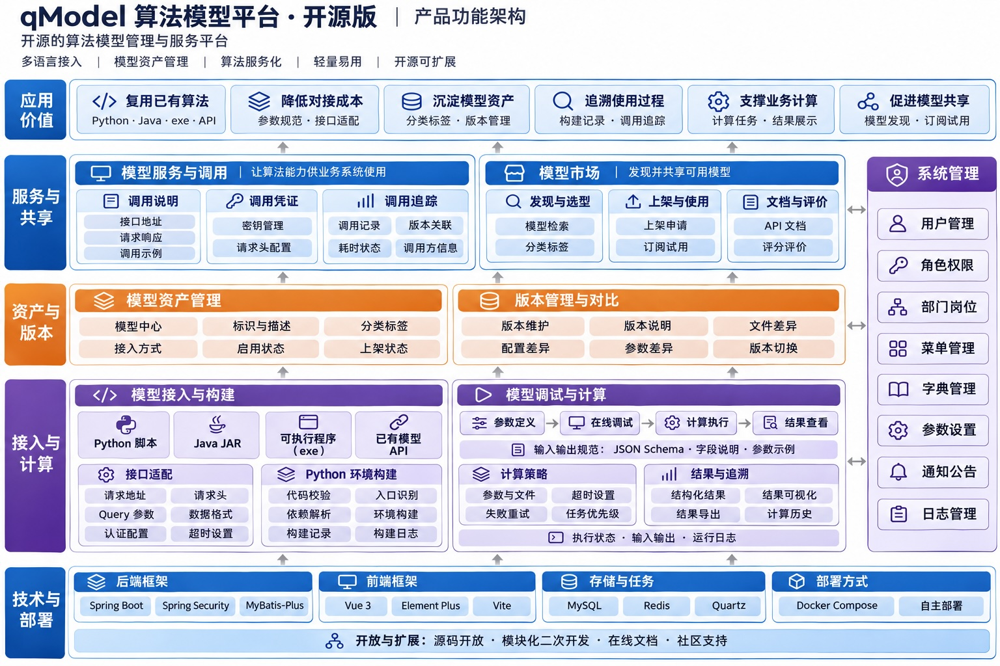

## 系统配图

<table>
    <tr>
        <td></td>
        <td>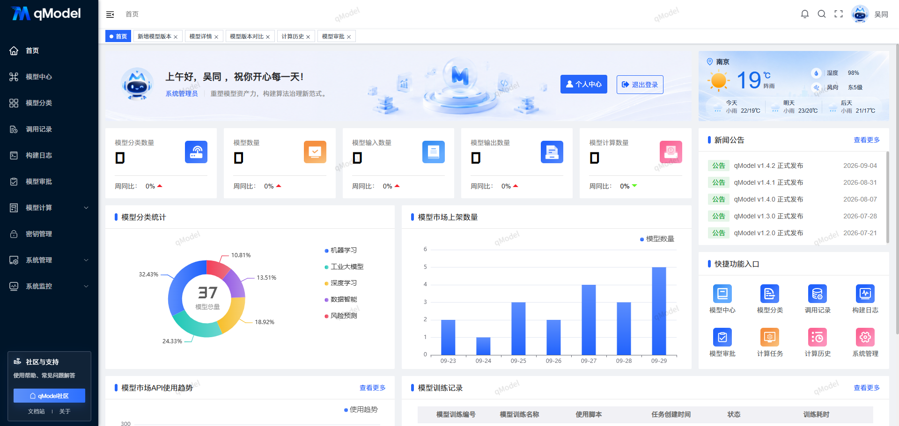</td>
    </tr>
    <tr>
        <td>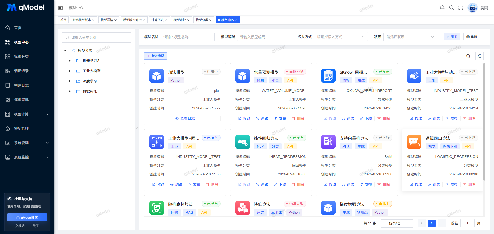</td>
        <td>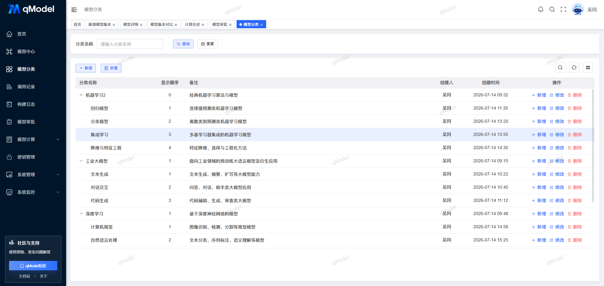</td>
    </tr>
    <tr>
        <td>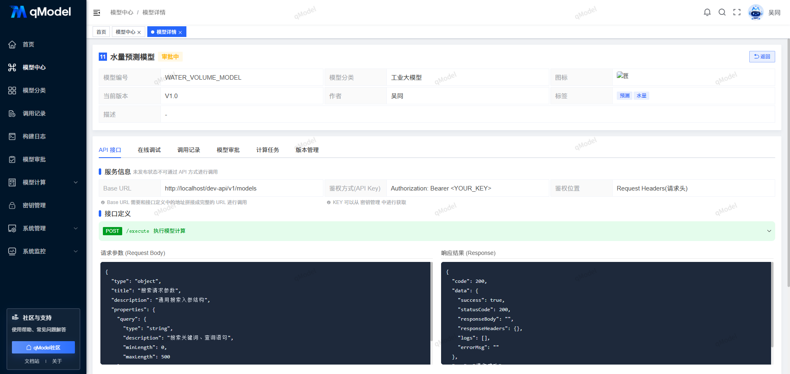</td>
        <td>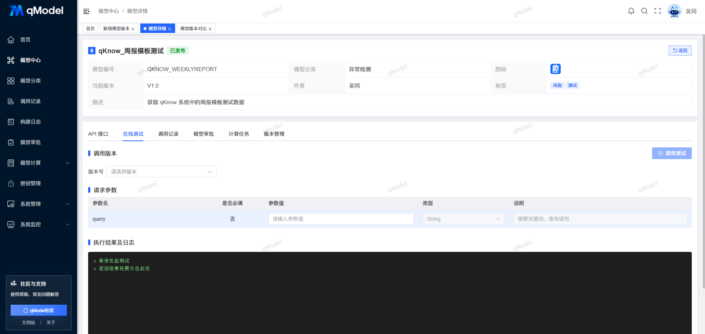</td>
    </tr>
    <tr>
        <td>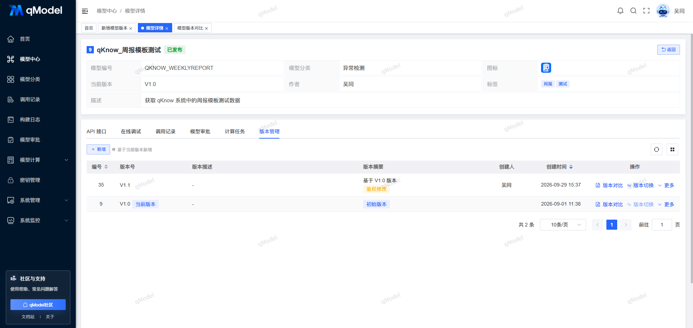</td>
        <td>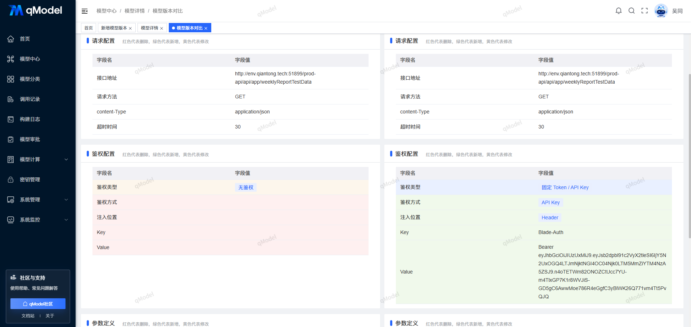</td>
    </tr>
    <tr>
        <td>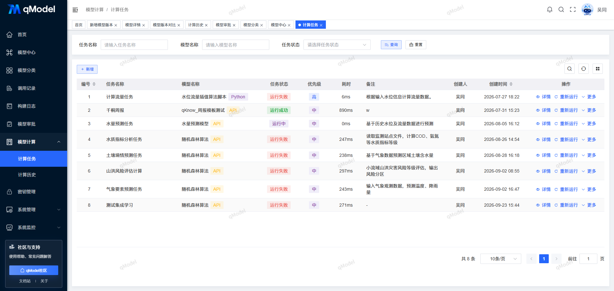</td>
        <td>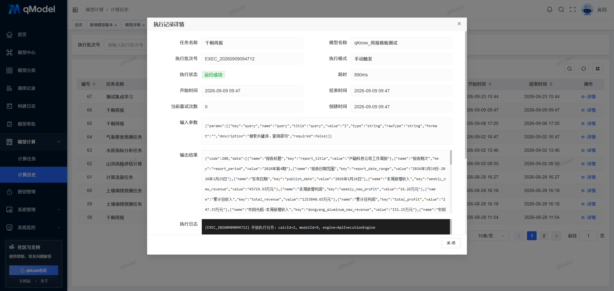</td>
    </tr>
    <tr>
        <td>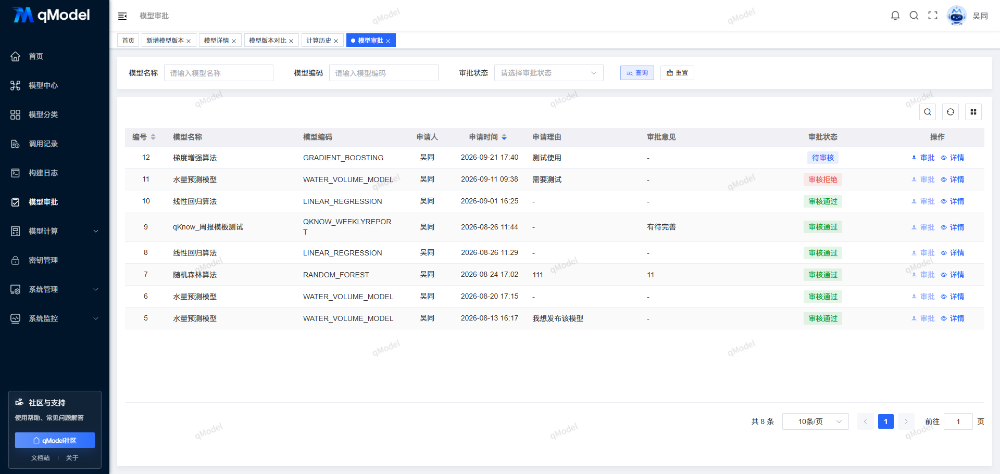</td>
        <td>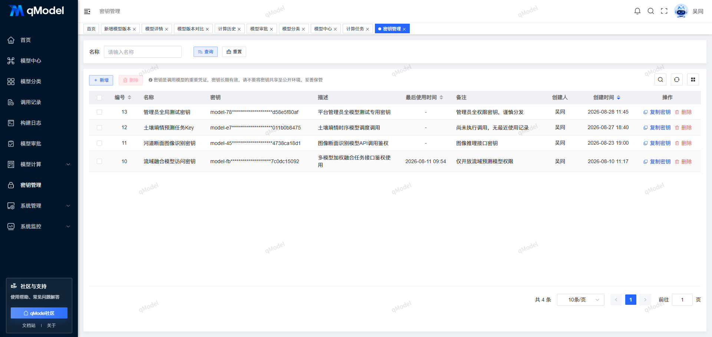</td>
    </tr>
</table>

## 能力概览

| 能力 | 可以完成什么 |
| --- | --- |
| **模型接入与接口适配** | 接入算法程序与已有模型服务；配置 API 地址、请求头、Query 参数、数据格式和超时，适配外部服务的固定或动态 Token 等认证要求。 |
| **模型资产与分类** | 维护模型标识、用途、分类标签、接入方式及启用、上架状态，按分类与业务用途查找和复用模型。 |
| **Python 运行环境与构建** | 校验代码文件、识别入口、解析依赖并组织运行环境；通过构建状态、时间和详情检查构建过程与结果。 |
| **输入输出规范与调试** | 使用 JSON Schema 定义输入参数，结合输出字段说明和示例形成调用约定；对指定版本检查响应、日志和输出结构。 |
| **版本管理与对比** | 维护版本描述，比较模型文件、配置和参数定义的变化，执行版本切换并追溯历史变更。 |
| **计算任务与执行策略** | 选择模型及版本，配置输入参数、文件、超时、重试次数与优先级，组织可管理的业务计算任务。 |
| **计算结果与可视化** | 查看结构化结果、字段解释与适用的图表，导出计算结果，通过执行记录复核输入、输出及运行过程。 |
| **模型调用与追踪** | 管理模型调用凭证，查看调用方、客户端 IP、模型版本、调用类型、耗时、时间和状态，辅助集成联调与问题排查。 |
| **模型市场与共享** | 通过分类、标签及评价发现模型，查看 API 服务文档，完成模型上架申请、订阅与试用，积累使用反馈。 |
| **用户与权限管理** | 管理用户、角色、部门、岗位、菜单、字典、参数、通知与日志，为模型使用和团队协作提供基础管理能力。 |

以上聚焦开源版的主要能力。详细操作请查阅[使用文档](https://community.qmodel.tech)，专业版扩展方向见[许可与商业服务](#license-and-services)。

## 模型接入与运行

qModel 支持 **Python、Java JAR、可执行程序及已有模型 API** 等多语言、多形态的算法模型，提供 **API 接入、Python 本地接入、SSH 远程接入** 三种接入方式。用户可根据算法模型的交付形态、部署位置及运行条件，灵活选择接入方式，无需对已有算法进行大规模改造，即可实现统一管理与调用。

| 接入方式 | 接入说明 | 接入前准备 |
| --- | --- | --- |
| **API 接入** | 通过 API 接口集成已服务化部署的算法模型，不受模型开发语言及技术框架限制，由 qModel 统一发起请求并获取计算结果，无需迁移模型及其运行环境。 | 准备 API 服务地址、请求方式、输入输出参数、认证信息等，并确认接口服务的可用性及网络连通性。 |
| **Python 本地接入** | 通过上传符合平台规范的 Python 模型文件夹，在 qModel 所在服务器上完成依赖安装与运行环境构建，支持本地运行及 Docker 容器化运行。 | 准备模型代码、模型依赖文件（`requirements.txt`）、统一执行入口（`predict.py`）及相关模型资源文件，明确 Python 版本、输入输出参数和运行环境要求。 |
| **SSH 远程接入** | 通过 SSH 连接外部服务器，远程执行 Python 脚本、Java JAR、可执行程序等不同形态的算法模型并获取计算结果，无需迁移模型，也无需提前将模型封装为 API 服务。 | 准备远程服务器连接信息、SSH 认证信息、算法运行脚本、执行命令及输入输出参数，确保远程服务器具备相应的模型运行环境。 |

模型接入后，平台对模型基本信息、版本信息、输入输出定义及运行配置进行统一管理。用户可通过在线调试或计算任务验证模型的运行情况及计算结果，验证通过后可供业务系统调用和团队复用，实现不同语言、不同形态、不同部署环境下的算法模型统一管理、统一调用与持续复用。

## 开发与扩展

qModel 采用前后端分离与模块化设计，便于开发者理解模型管理流程、接入业务系统和扩展功能。

| 层次 | 主要技术 |
| --- | --- |
| 后端 | Java、Spring Boot、Spring Security、MyBatis-Plus |
| 前端 | Vue 3、Element Plus、Vite、Pinia、ECharts |
| 任务与数据存储 | Quartz、MySQL、Redis、本地文件存储 |
| 部署 | Docker Compose 或自主部署，按模型类型准备相应运行环境 |

开发环境、初始化配置和启动步骤见[源码启动指南](https://community.qmodel.tech/docs/deploy/manual-deployment/)。依赖版本以所用发布版本的构建与配置文件为准。

## QQ交流群
欢迎加入 qModel 官方 QQ 交流群，获取最新动态、技术支持与使用交流。 👉 <a href="https://community.qmodel.tech/discuss.html">点击加入 QQ 交流群</a>

## 许可与商业服务

qModel 按 **Apache License 2.0 及项目附加条件**提供，支持商业使用。使用时需遵守 [LICENSE](LICENSE)，保留其中要求的 Logo、版权、许可与署名信息。

如需去除或修改相关标识、白标、OEM 或重新包装为其他产品，请取得相应商业授权。品牌定制授权、专业版与技术服务咨询，请查看[商业合作说明](https://community.qmodel.tech/business/policy.html)。

## 我们的使命与愿景

**让每一位开发者、每一家企业，都能更容易地管理、使用和复用算法能力。**

我们希望算法成果能够被清楚地交付、持续地维护，并真正用到业务中。qModel 以开源连接算法作者、业务开发者与使用团队，让不同语言、不同来源的模型拥有清晰的版本、参数和调用方式，让一次算法研发的成果能够服务更多项目。

我们期待与社区共同建设一个易用、开放、可持续扩展的算法模型平台，让个人的算法经验成为可复用的能力，让团队积累的模型持续创造价值。
